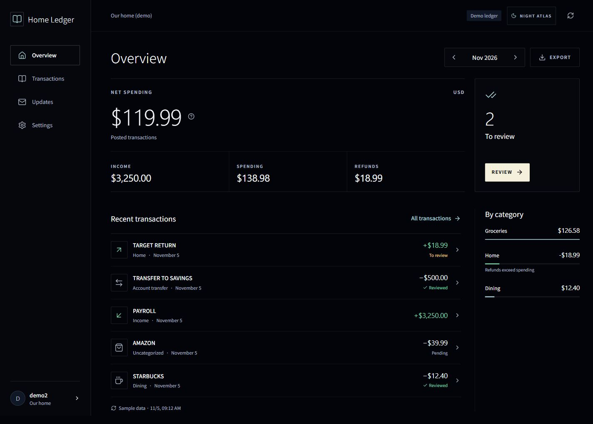
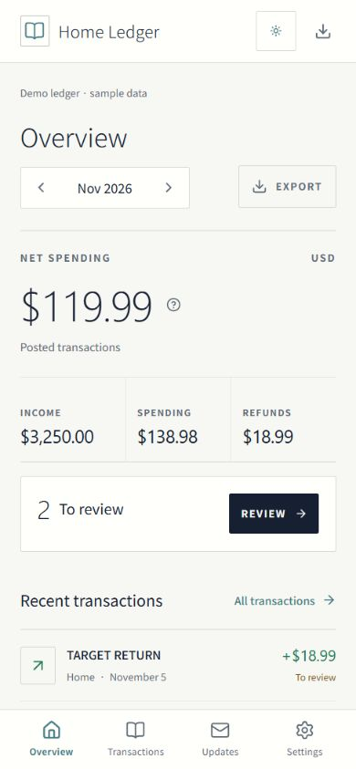

# Home Ledger

A self-hosted household ledger for one USD checking account and up to two people. Review spending together, add category labels, and export your records.

Built with NestJS, React, PostgreSQL, and [Hoshikuzu UI](https://github.com/Startust/hoshikuzu-ui). Install the PWA on an iPhone from Safari using **Share → Add to Home Screen**.



## Features

- Monthly income, spending, and transactions awaiting review.
- Multiple category labels per transaction, notes, and edit history.
- Automatic income review; swipe to delete a category without deleting transactions.
- Plaid bank connection, transaction sync, and reconnect flow.
- CSV and PDF exports for the current month or filtered transactions.
- Shared accounts with separate logins and personal inbox read status.
- Night and Archive themes, responsive layouts, and app-styled confirmations.

<details>
<summary>Archive theme on mobile</summary>



</details>

## Try it locally

Requirements: Node.js **24.22.1** (see `.nvmrc`), npm, and Docker with Compose. Dependencies and container images are pinned.

```sh
git clone https://github.com/Startust/household-ledger.git
cd household-ledger
npm ci
node scripts/init-local.mjs
docker compose up -d --wait postgres
npm run db:migrate
npm run build
npm run seed:demo
npm start
```

Open **http://127.0.0.1:8765**. Sign in as `demo1` or `demo2` with `LocalDemo!2026`. These are sample accounts for local use. The seed command refuses production environments and nonempty databases.

On Windows, `./scripts/setup.ps1 -Demo` performs the setup steps; then run `npm start`.

The demo does not need Plaid credentials. Run `npm run worker` in a second terminal for bank sync and daily inbox updates. Stop foreground processes with Ctrl+C; `docker compose stop` preserves the database volume.

## Use your own ledger

Start with an empty database and skip `seed:demo`. Provision the first login interactively:

```sh
npm run cli -- create-household your-username
```

The command prints the household ID. You can add one more member:

```sh
npm run cli -- add-member HOUSEHOLD_ID another-username
```

Passwords are entered through a hidden prompt. Configure Plaid credentials to connect a bank; connecting a real account requires your own Plaid production access. See [configuration](docs/CONFIGURATION.md) and [Railway deployment](docs/RAILWAY.md).

## Documentation

- [Development and tests](docs/DEVELOPMENT.md)
- [Configuration and account administration](docs/CONFIGURATION.md)
- [Railway deployment and operations](docs/RAILWAY.md)
- [API reference](docs/API.md)
- [Architecture and data rules](docs/ARCHITECTURE.md)
- [UI design](docs/DESIGN.md)
- [Contributing](CONTRIBUTING.md) · [Security](SECURITY.md)

## Scope

Home Ledger supports one USD checking/debit account per household and at most two provisioned members. There is no public signup, credit-card support, transaction amount splitting, or manual transaction import. Multiple labels do not split an amount: overall totals count each transaction once, while category totals can overlap.

Inbox updates are in-app; email and push notifications are not implemented. The PWA caches the app shell, not bank data, so financial screens require a connection. Mobile browser layouts are checked; installation on a physical iPhone and live bank authorization must be verified for your deployment.

## License

[MIT](LICENSE). Vendored UI and font licenses are listed in [third-party notices](THIRD_PARTY_NOTICES.md).
