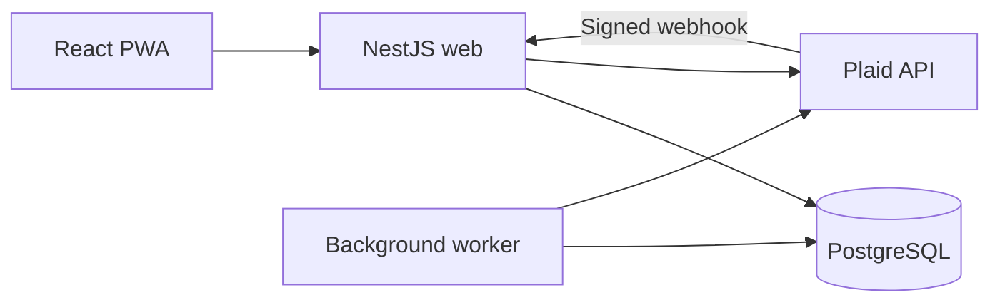

# Architecture

Web and worker use the same image, schema, and runtime configuration. Only web needs a public endpoint. PostgreSQL stores sessions, ledger data, sync state, and inbox updates; no Redis or local database is required.

## Modules

| Module                                | Responsibility                                                                        |
| ------------------------------------- | ------------------------------------------------------------------------------------- |
| `bootstrap.ts`, `static.ts`           | HTTP configuration, sessions, CSRF, validation, safe errors, OpenAPI, and PWA serving |
| `auth.ts`, `config.ts`, `database.ts` | Account provisioning, authentication, validated environment, and database access      |
| `controllers.ts`, `dto.ts`            | HTTP routes and validated request contracts                                           |
| `ledger.ts`                           | Categories, versioned edits, monthly summaries, digests, and read receipts            |
| `exports.ts`, `export-renderer.ts`    | Consistent snapshot exports, CSV encoding, and paginated PDF rendering                |
| `bank.ts`, `plaid.ts`                 | Bank linking, account selection, token encryption, and webhook verification           |
| `sync.ts`, `worker.ts`                | Atomic provider sync, retries, and scheduled work                                     |
| `cli.ts`                              | Provisioning, password resets, and local sample data                                  |
| `web/src/`                            | Session lifecycle, financial views, settings, exports, and UI themes                  |

## Data rules

- Amounts are integer cents backed by database integers/BigInt. Positive values represent outflows; negative values represent inflows. JSON conversion checks safe integer bounds.
- A household has one bank connection and at most two provisioned members. Every authenticated request derives household scope from the current user.
- Monthly summaries use posting dates. Pending and removed transactions are excluded; transfers are excluded from net spending.
- Transactions can have multiple category labels. Overall totals count each transaction once; category spending includes the full expense/refund amount under every assigned label and may overlap. Income and transfers are excluded from category spending.
- Deleting a category removes only that label. Transactions and other labels remain; a transaction with no labels is Uncategorized. Affected transaction versions and edit history are updated.
- Income is automatically reviewed and excluded from outstanding-review filters and counts. Pending bank status remains separate from review state.
- Provider fields cannot be edited through the transaction API. Manual edits require the current `version`; stale writes return 409.

`TransactionCategory` holds label associations. The compatibility `category_id` column remains for legacy single-category reads/writes. New edits update both representations.

## Concurrency and synchronization

Category changes, transaction edits, and bank sync serialize on the household lock. Bank and transaction locks follow it in that order. Provider identity is unique per bank connection.

All pages of a provider sync, transaction changes, and the new cursor commit together. Provider failures roll back imported changes and persist retry backoff. Durable request/completion counters avoid losing requests made during a running sync.

Pending-to-posted replacement preserves labels, notes, and compatible manual flow choices. Changes to amount, name, or flow clear non-income review state. Initial imported history does not generate new-activity notifications.

The worker runs every 30 seconds, uses exponential retries capped at six hours, and requests catch-up sync every six hours. Run one worker replica. Daily digests lock the household and use its timezone; each member has separate read receipts.

## Exports and browser storage

CSV and PDF use the same transaction filters and a repeatable-read database snapshot. Requests exceeding 5,000 transactions fail with 422 instead of truncating. Each transaction occupies one row, with category names together. CSV text is escaped against spreadsheet formula injection. PDF generation uses the bundled, licensed CJK font.

API responses and exports are not cached. The service worker precaches public build assets only. Sessions use cookies; the CSRF token stays in memory. Theme preference is stored locally. Financial screens require a network connection.

## Operations

`/health/live` checks the web process; `/health/ready` additionally checks PostgreSQL. Neither verifies worker activity or bank freshness. Monitor those separately. Database constraints, migrations, and the integration suite enforce the invariants above; see [deployment](RAILWAY.md) for backup and upgrade guidance.
